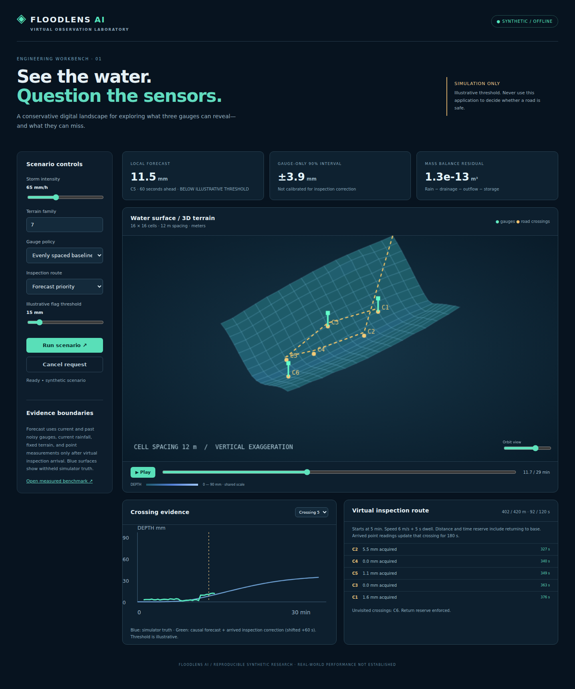
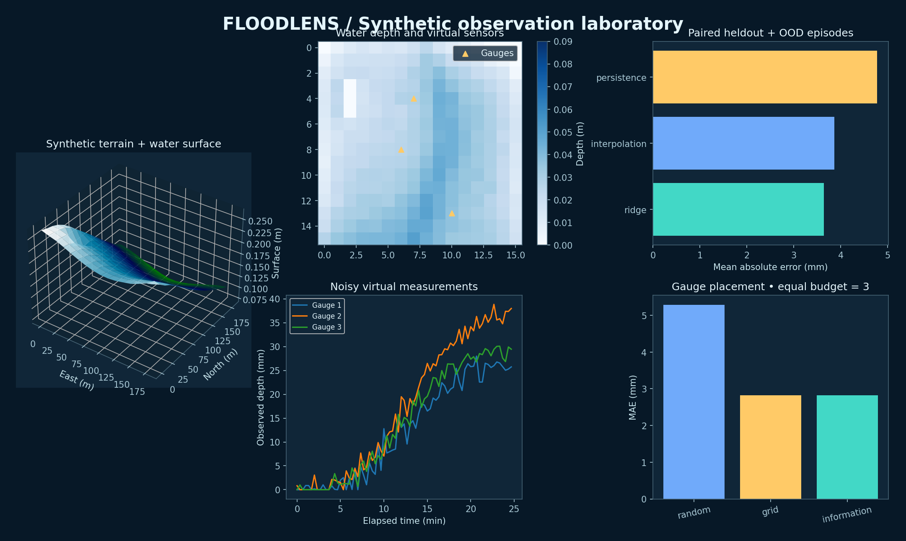
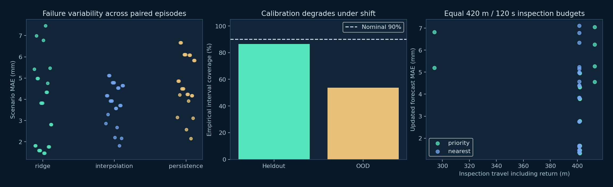
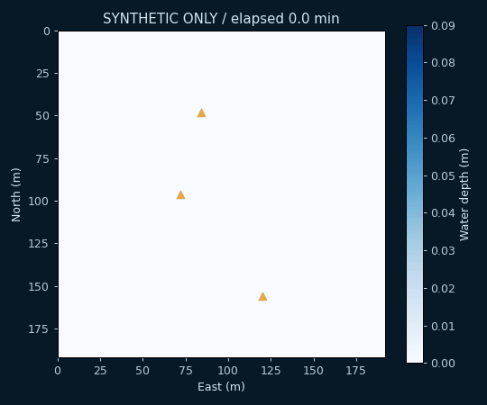

# Problem Statement

[](https://github.com/mirmoosa1014-rgb/floodlens-ai/actions/workflows/ci.yml)

# FloodLens AI
### A virtual observation laboratory for imperfect flood sensing

Can three noisy virtual gauges predict near-term depth at six road crossings on unseen synthetic terrain? FloodLens couples a mass-conserving storage-cell simulator with a small learned nowcaster and compares equal sensing budgets. Inputs are terrain, synthetic rainfall, gauge locations, and current/past noisy observations. Outputs are 60-second depth forecasts, empirical uncertainty intervals, illustrative crossing flags, and a distance/time-constrained virtual inspection plan. Success means lower heldout depth error without silently increasing missed flags or overstating uncertainty coverage.

**Simulation only. Synthetic validation does not establish real-world flood prediction or road safety. Never use this app to decide whether to enter floodwater.** This project is independent of the Flood Drone hardware application.





*Real application screenshot above; benchmark figure below is generated from the full bounded experiment. Surface elevations are vertically exaggerated. No field photograph or physical drone flight is implied.*

## Explore the workbench

- Rotate a genuinely projected 3D terrain/water surface, animate a 30-minute storm, and inspect gauges and road crossings.
- Change terrain family, storm intensity, equal-budget gauge policy, inspection policy, and illustrative flag threshold. Each run uses the Python engine.
- Compare causal 60-second forecasts with withheld simulator truth. Inspection readings update a crossing only after arrival.
- Inspect a virtual route with travel/dwell time, a 420 m / 120 s budget, and return-to-base reserve.
- Read saved measurements, model weights, family split identities, calibration failures and paired baseline comparisons.

## Measured findings

The full bounded run trains on **9,936 rows from 24 whole episodes in terrain families 0–5**, calibrates on families 10–11, and evaluates **8 paired storm episodes in families 20–23 under three gauge-placement policies** (24 policy-episode combinations). Heldout storms peak at 70 mm/h; deliberately out-of-distribution storms peak at 150 mm/h. Three gauges and six virtual crossings are used throughout.

| Method | Aggregate depth MAE |
|---|---:|
| Ridge nowcast, gauges only | 3.644 mm |
| Current inverse-distance interpolation | 3.859 mm |
| Stale interpolated-estimate persistence | 4.777 mm |
| Forecast-priority inspection correction | 3.510 mm |
| Nearest-site inspection correction baseline | 3.525 mm |

The nominal **90%** gauge-model interval covers only **70.0%** of heldout/OOD targets. It is poorly calibrated outside validation conditions and is not calibrated for the inspection-corrected forecast. A smaller quick run shows an unfavorable learned outcome (**6.345 mm vs 4.237 mm interpolation**). Neither run supports an unqualified claim that ML is superior. The priority/nearest inspection difference is small and has no confidence/significance claim.



Individual policy/terrain failures, flag recall/false-alert rates and measured first-alarm lead times appear in [metrics.csv](results/metrics.csv); [route_metrics.csv](results/route_metrics.csv) compares equal inspection budgets. [summary.json](results/summary.json) records the full run; [quick-summary.json](results/quick-summary.json) and [quick-metrics.csv](results/quick-metrics.csv) retain the smaller counterexample. Repeated target rows and policy variants are correlated. No row-independent confidence intervals are claimed.

Paired policies share terrain, rainfall, and coordinate/time-seeded observation noise: the same physical site/time receives exactly the same noisy measurement. Gauge position changes what can be observed. Inspection observations are acquired only at the rounded-up arrival step, then causally update that crossing for at most 180 seconds.

## Start locally

Use Python 3.11+ (verified here on Python 3.12), Node 20.19+ and npm. No hardware, API key, cloud service, external dataset, or GPU is needed. Dependencies install once; experiments and application then run offline.

```bash
python3 -m venv .venv
source .venv/bin/activate
python -m pip install -r requirements.lock
cd frontend
npm ci
npm run build
cd ..
python -m uvicorn floodlens.api:app --host 127.0.0.1 --port 8103
```

Open **http://127.0.0.1:8103**. The small checked-in JSON model and saved benchmark mean no manual training is needed for the working example. For frontend development run `npm run dev` in a second terminal at http://127.0.0.1:5103. API docs: http://127.0.0.1:8103/docs. Requests are bounded to 16×16 cells and 90 steps. Cancellation aborts the client request, not an already executing short synchronous calculation.

## Verify and reproduce

```bash
python -m pytest -q
python -m floodlens.experiment --quick
python -m floodlens.experiment
python scripts/render_evaluation.py
cd frontend && npm run build
# Optional live browser check: starts and stops its own loopback server.
npx playwright install chromium
node browser-check.mjs
```

Experiments overwrite representative outputs/model; the repository separately retains quick-run evidence. To regenerate that evidence, run quick then copy summary/metrics to quick-summary/quick-metrics before the full run. [Saved surface/observations](results/representative.npz) and [gauge trace](results/demo_trace.csv) accompany representative visuals. `scripts/reproduce.sh` runs tests, the full experiment, supplementary chart and frontend build.

**Verified:** 12 meaningful Python tests, TypeScript checking, Vite production build, quick/full experiments and API integration. A genuine live-browser interaction check and screenshot are included. A clean isolated Python installation from pinned requirements and a clean `npm ci` both passed. The CI badge below reports hosted verification status. See [progress](docs/progress.md) for exact checks and recovery history.

## Scope and limits

The physics is a transparent **storage-network approximation**, not a validated shallow-water solver or calibrated catchment model. Conductance is fixed per network edge rather than scaled with grid spacing; temporal convergence is tested but continuum spatial convergence is not claimed. There is no channel momentum, calibrated infiltration, real DEM, operational alert delivery, or live drone control. Crossing locations are synthetic points, not geospatially verified roads.

Gauge placement uses static terrain-relief/separation information as a heuristic, **not** a proven adaptive information-gain optimizer. Inspection correction is a simple causal point-depth correction plus model-predicted trend, not a learned spatial assimilation filter. Inspection routes start at 5 minutes in the interactive case; benchmark plans start from the first evaluated forecast at 60 seconds. The UI labels this timing. Planning is a single bounded sortie, not adaptive mission replanning.

Uncertainty is an empirical validation residual quantile, not a Bayesian posterior. The interval fails under shift and is not applied as a confidence guarantee to corrected point readings. `lead_time_s` measures first pre-onset alarm against synthetic onset; zero also covers no observed onset or no timely alarm. Alert thresholds are illustrative and never signify a safe crossing.



## Engineering notes

[Architecture](docs/architecture.md) · [Model card](docs/model.md) · [Evaluation](docs/evaluation.md) · [Plain-language explanation](docs/explain.md) · [90-second demo](docs/demo.md) · [Project summary](docs/project-summary.md) · [Recovery/progress](docs/progress.md)

The user supplied project direction. Codex implemented this version and its tests/documentation; user review and subsequent modifications are separate contributions. No awards, users, field results or primarily human authorship are claimed. Source and reproducible evidence are available in the repository linked below.


## Repository

[Source and releases](https://github.com/mirmoosa1014-rgb/floodlens-ai) · [Continuous integration](https://github.com/mirmoosa1014-rgb/floodlens-ai/actions)
